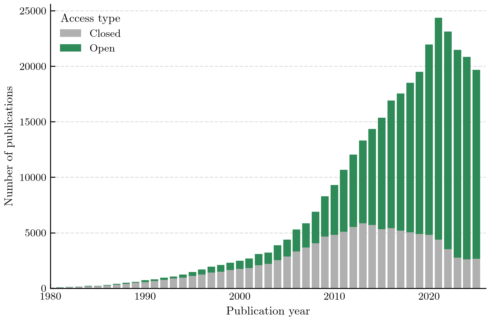
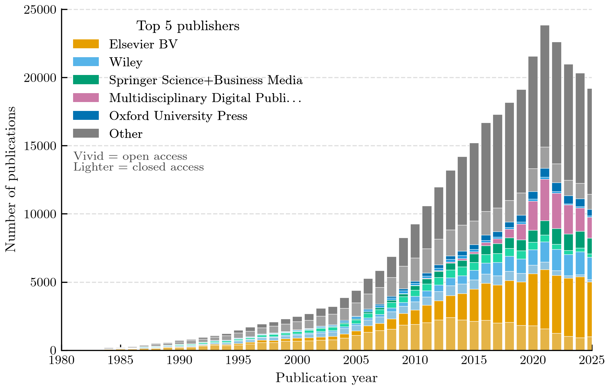
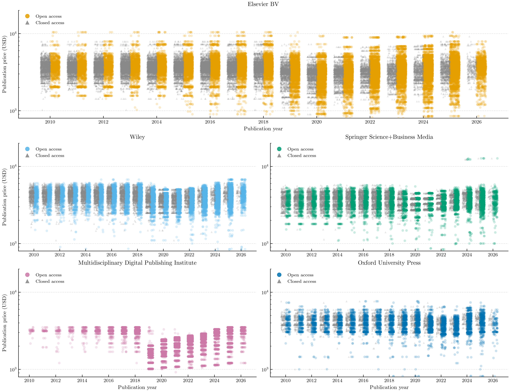

# Adri's Plots list or research

## Pending

## Done

- [x] Open papers vs closed papers by year (has catalan science moved to a open access or closed one?)

- [x] Quantity of catalan published papers on top 5 publishers (are we depending on specific editorials)? Contrast with european journals.

- [x] Price comparision of top 5 papers on each science domain per year (should see that the covid year price is lower for health science?)

